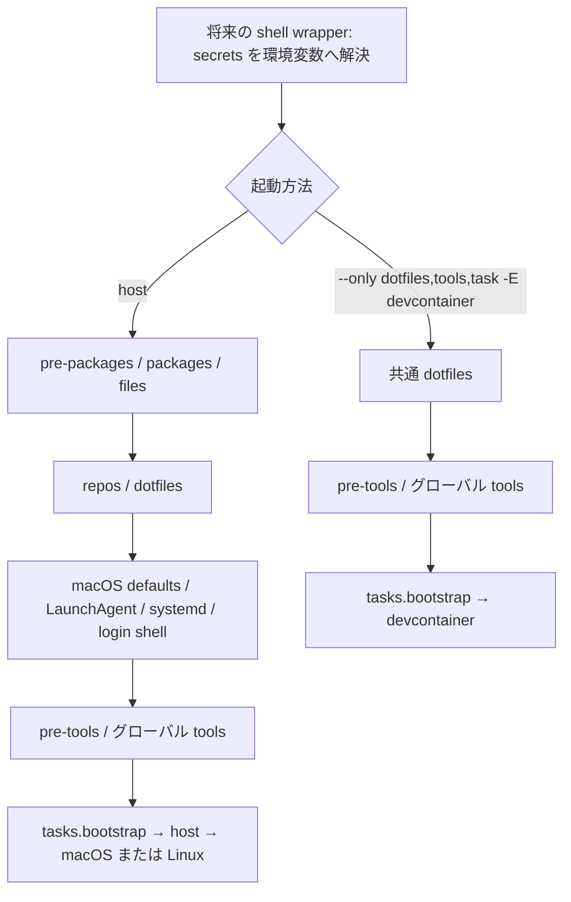

# Mitamae → mise bootstrap 移行草案

対象は mise **2026.10.10**。`cookbooks/*/default.rb` 全 67 本と
`roles/{base,darwin,ubuntu,devcontainer}/default.rb` を読んだ棚卸しであり、
このまま適用できる完成版ではない。補足として `roles/debian/default.rb`、
`lib/{recipe,recipe_helper,helper,secrets,gcloud}.rb`、関連設定も確認した。
新規ファイルは `mise.toml`、`mise.devcontainer.toml`、本書の 3 本のみ。
既存ファイル・実機設定は変更していない。

将来の入口は host が `mise bootstrap`、devcontainer が
`mise bootstrap --only dotfiles,tools,task -E devcontainer`。
今回は apply、status、plan、dry-run、task、インストーラーを実行しない。
CLI の確認はバージョン表示と `mise bootstrap --help` に限定した。

## 草案の構成と順序

- ルートの `[tools]` は設けない。言語・CLI のグローバル定義は
  `config/mise/config.toml` に残し、dotfiles で `~/.config/mise/config.toml` に配置する設計。
  **現在存在するのは `config/mise/config.toml.erb` のみ**。
  指定された 3 ファイル制約に従い、配置元の作成・改名はまだ行っていない。
  したがって現状の草案には未解決の source が 1 本ある。
- `mise.devcontainer.toml` は追加ロードする差分。`vars.role` と `vars.codex_home`、
  devcontainer 専用 task を定義する。親の packages・services を消す設定は使わず、
  指定の `--only` で外す。`-E devcontainer` 単独では host パッケージ等が残る。
- `[tasks.bootstrap]` が role ごとの task を順次呼ぶ。host 内の macOS/Linux 処理にも
  role/OS guard を置く。devcontainer は SSH の readonly bind mount に書き込まない。
- 各 `source` は宣言した config ファイルのディレクトリ基準。
  3 ファイルともリポジトリ直下にあるため、通常は `config/...` で解決する。
- `pre-packages` は brew CLI と apt 外部 source の準備、`pre-tools` は mise plugin 登録。
  `--only dotfiles,tools,task` では pre-packages は実行対象外で、pre-tools は対象になる。
  ホスト上で `mise` 自身を導入する入口は別途必要。mise を動かしてから自分を導入する
  `curl https://mise.run | sh` は bootstrap 内には移さない。

サービスが tools/task より先という順序は Mitamae の cookbook 順序と異なる。
特に yui の gcloud/Python 依存は後述の未解決事項であり、この図は稼働確認を意味しない。

## 振り分け結果（変換ルール 1〜8）

### 1. パッケージ

有効な role が参照する cookbook は 59 本。darwin は 56 本、ubuntu は 33 本を参照し、
30 本が共通。devcontainer は base を参照するが cookbook を直接参照しない。
`roles/debian` は ubuntu をそのまま読み込む。

- `basic` → `[bootstrap.packages]` の brew/apt 共通 CLI と Linux ビルド依存。
  Ubuntu の `software-properties-common`、Debian の `apt-transport-https` は
  distro 分岐を持つ pre-packages hook。locale 処理は要判断として保留。
- `git` → brew/apt の `git` と `git-lfs`。
- `rust` → brew/apt の `cmake`、`pkg-config`、macOS の `openssl`、Linux の
  `libssl-dev` と Wayland/XCB 開発パッケージ。rustup/Cargo は task。
- `mise` → Python ビルド用 apt 依存と macOS の `tflint`。
  Linux tflint は task、plugin は pre-tools、グローバル設定は dotfiles。
- `go` → macOS の `brew:go` と Linux の `apt:golang`。
- `htop`、`emacs`、`eza`、`nkf` → 同名の brew/apt エントリ。
- `zsh` → Linux の `apt:zsh`。macOS は `/bin/zsh` を使用。
- `gh`、`k6` → brew/apt。Linux の鍵/source は pre-packages。
- `redis` → `apt:redis` と pre-packages の source。cookbook に darwin 分岐があるが
  darwin role からは呼ばれないため、`brew:redis` は有効化しない。
- `gibo` → macOS の `brew:gibo`。Linux の github_binary は後述の保留対象。
- `gemini-cli` → macOS の `brew:gemini-cli`。Linux の npm インストールは task。
- `herdr` → macOS の `brew:herdr`。Linux の公式インストーラーは task。
- `docker` → brew の CLI formula 4 本（`docker`、`docker-compose`、`docker-buildx`、
  `docker-credential-helper`）と共通依存。Linux は `docker-ce`、`docker-ce-cli`、
  `containerd.io`、`docker-buildx-plugin`、`docker-compose-plugin` と外部 source。
  Docker Desktop cask は追加しない。
- `colima`、`dnsmasq`、`mkcert` → macOS の brew formula。mkcert は `nss` も含む。
- `mas`、`helm`、`jq`、`gnu-sed` → macOS の brew formula。
  `helm` の Linux 分岐は現行 role で到達しない。
- `pulseaudio` → `apt:pulseaudio-utils`、`sound-theme-freedesktop` → 同名 apt。
- `bitwarden` → `mas:1352778147`、`line` → `mas:539883307`。
  Bitwarden はブラウザ統合の理由から既存の App Store 配布経路を維持。
- `android_studio`、`aqua-voice`、`chatgpt`、`cursor`、`discord`、`ghostty`、
  `linear`、`obs`、`raycast`、`slack`、`vivaldi`、`vlc`、`xquartz`、`zoom`
  → 実装が明示する `brew-cask:`。token は元の命令を保持し、
  `cursor` は `cursor` と `cursor-cli`、`linear` は `linear-linear`。
- `darwin_base` → `brew-cask:font-meslo-lg-nerd-font` と `[bootstrap.brew.taps]`。
- `gcloud` と `karabiner-elements` → 元の実装は `package` のみで cask 指定がなく、
  formula/cask と現在の token が未確定。推測した有効エントリは置かず保留。
  gcloud の Linux installer、Karabiner の設定リンクは別途変換した。

role から未参照の次の 8 本も全て読んだが、移行に伴う新規有効化はしない。

- `bat`、`bottom` → package と zsh alias 追記。現行は rust cookbook の Cargo 経由で
  バイナリを導入するため、独立 cookbook の package/alias は無効のまま。
- `google-chrome` → `brew-cask:google-chrome` 候補。
- `mysql` → `brew:mysql` 候補。
- `postgresql` → `brew:postgresql@15` 候補。`15` は formula 名の一部。
- `sd` → `cargo install sd` 候補。
- `gpg-agent` → Linux `gnupg-agent`、設定ファイル配置、systemd unit の vendor ファイル編集、
  service/socket 起動候補。vendor unit を直接編集する移植は避け、drop-in 等を要検討。
- `ssh-agent` → user unit、`.pam-environment`、enable 用リンクと service 起動候補。
  `.pam-environment` の source は参照されるが、この checkout には存在しない。

### 2. dotfiles

- `roles/base` の Claude/Cursor 共通 skills・hooks、user rules と各製品専用ファイルを
  `[dotfiles]` に割り当てた。`~/.claude` は `config/coding_agents/claude`、
  `~/.cursor` は `config/coding_agents/cursor` を **symlink-each** で展開する。
  Claude の CLAUDE.md/agents/output-styles/statusline.sh/render-diagram.sh と
  Cursor の hooks.json/rules/coding.mdc はこの再帰展開で含まれる。
- 共通 skills/hooks はそれぞれ別エントリの symlink-each。
  `skills/synced`、`hooks/herdr-agent-state.sh`、state と Python cache を除外し、
  同期・実行時生成物を repo へ逆流させない。`.erb` も root 展開から除外する。
  Cursor の rules も symlink-each の再帰処理で実ディレクトリになる。
- base の `.cargo/config.toml`、`.config/boto`、`.config/sheldon`、`.zsh`、`.zshrc`、
  OS 別 `.zshrc.darwin` / `.zshrc.Linux` を通常 symlink に変換。
  OS 固有の dotfiles は確認済みの `variants = [{ os = "..." }]` を使用。
- base の `.gitconfig` / `.gitignore_global` は既存ファイル保持の guard がある。
  dotfiles の `not_if` を創作せず、配置予定をコメントで記録し、共通 task に
  「対象が存在しなければリンク」を移した。元の helper が block の guard を
  期待どおり適用するかは別問題として、ここでは role に記述された意図を保持する。
- darwin/ubuntu の `.tmux.conf`、herdr の `.config/herdr/config.toml`、ssh の
  `.ssh/config.d/00-base.config` と macOS 専用 `10-darwin.config` は
  `[dotfiles]` にコメントで配置予定を列挙し、host task の guard 下でリンクする。
  親の有効な宣言を devcontainer の追加ファイルで取り除く構成にはしない。
  この 4 本は role 分離を宣言だけで表す方法が決まるまでの命令的変換。
- darwin の `.config/ghostty` と Karabiner の手書き `ln` は通常 symlink。
  Karabiner の固定 `~/.dotfiles` 前提は config 相対 source に置き換えた。
- base の `claude-sync-mcp` / `codex-link-auth` は `.local/bin` の symlink として宣言。
- Colima/Traefik のファイルは元の `install -m 0644` と `cmp -s` を task に保持。
  dnsmasq の `/etc/resolver/test` と親ディレクトリは `[bootstrap.files]` /
  `[bootstrap.directories]` に分離した。特権パスを dotfiles に混ぜない。

### 3. macOS defaults

- `darwin_base` の `defaults write` → `[bootstrap.macos.defaults]`。
  bool/int/string/float の区別を維持し、`ShowPercent = "YES"`、scaling は `3.0`。
- `-currentHost` の screensaver `idleTime=0` と `com.apple.mouse.tapBehavior=1` は
  同バージョンの公式資料で確認した `[[bootstrap.macos.defaults_entries]]` と
  `host = "current"` に分離。通常スコープに読み替えない。
- Bluetooth trackpad の `Clicking` は元の同一 cookbook で bool true と int 1 が
  重複する。草案は後の命令の int 1 を採用したが、元の guard により最終結果は
  実機状態にも依存する。意図が bool か int かは要判断。
- `JIMPrefLiveConversionKey 1` は元命令に型指定がないため、数値の見た目だけで
  int と推定せず文字列 `"1"` にした。macOS 側が要求する型は要確認。
- 入力ソース配列、ショートカットの PlistBuddy、osascript の dark mode、pmset は task。
  `raycast` の plist import も task。ショートカットは従来のまとめた guard を
  項目単位に分け、必要な値だけ収束させる。PlistBuddy の対象キー不存在は未処理。

### 4. yui サービス

- `yui` の plist/service ERB 2 本は **config 配下の 6 本とは別**。
  program/args/environment/再起動方針を `[bootstrap.macos.launchd.agents.yui-proxy]`
  と `[bootstrap.linux.systemd.units.yui-proxy]` に変換した。
- `CLOUDSDK_ACTIVE_CONFIG_NAME` を `vars.gcloud_configuration` から渡し、
  project ID は書かない。既定 `good` と環境変数上書きの意図を維持。
  `lib/gcloud.rb` の空文字・空白も既定値に戻す挙動は、Tera 化の際に追加整合が必要。
- mise は `dev.mise.yui-proxy.plist` / `dev.mise.yui-proxy.service` を作る。
  旧 `com.tepein.yui-proxy` / `yui-proxy.service` を自動で引き継がない。
  同一ポート 52981 の二重起動を避ける切替手順と、
  `config/.zsh/lib/functions` の再起動先修正が必要。今回はどちらも変更しない。
- macOS の gcloud は `/opt/homebrew/bin/gcloud`、Python は元の 3.12 パスを保持。
  Intel Mac のパス、mise の実インストールディレクトリとの一致は要確認。
- yui の宣言適用は tools/task より前。Linux の gcloud installer は task、macOS の
  gcloud package は未確定、Python 3.12 は tools なので、初回の起動順序は未完成。
  依存導入を前倒しするか、初回の起動を後段に分ける実装を次段階で決める。

### 5. login shell

- `zsh` の chsh → `[bootstrap.user] login_shell = "/bin/zsh"`。
  macOS の dscl/dscacheutil の fallback と、Linux の「元が bash のときだけ変更」は
  mise の状態管理に置き換わるため挙動差がある。Linux で他 shell を保持する必要は要判断。
- sheldon は Cargo task。既存 zsh 設定が mise activation を持つため、
  `[bootstrap.mise_shell_activate]` は空の予約セクションとした。
  `zsh = true` を重ねると `.zshrc` の symlink 経由で repo を編集する可能性がある。

### 6. リポジトリ

- `fzf` → `[bootstrap.repos]` の `~/.fzf` と task の `install --all`。
  clone と install を分離したため、install 完了は binary と `.fzf.zsh` で確認する。
  `--depth 1` の宣言キーは確認できないため省略し、shallow clone の差分を記録する。
- `ghq` は CLI/plugin 導入だけで、`ghq get` 等の clone 対象は cookbook に存在しない。
  clone URL は創作しない。ghq plugin は pre-tools、CLI はグローバル tools に残す。

### 7. 命令的処理

- `brew` → pre-packages の存在確認付き公式 installer。mise の brew manager は
  brew CLI なしでも package を扱えるが、Colima/dnsmasq の `brew services` に CLI が必要。
  毎回の `brew update` は省き、更新操作と初期構築を分離する差分として記録。
- `claude` → host task の native installer、LSP バイナリ、plugin。
  marketplace 判定は必ず `claude plugin marketplace list` の出力を使い、
  cache ディレクトリの存在判定へ戻さない。公式 Codex plugin は host のみに残す。
- `colima` → template の cmp、既存 VM の差分警告、service への引渡し、起動確認、
  Docker 応答を最大 60 秒待つ処理。VM の削除・再作成は自動化しない。
- `dnsmasq` → `brew --prefix` に応じた conf、変更時 restart、停止時 start。
  package 導入通知そのものは mise では同じ形で渡せないため、conf/プロセス状態で判定。
- `mkcert` → System keychain の証明書確認付き `mkcert -install`。
- `traefik` → 設定 3 本の cmp/install、証明書生成、Docker 利用可否 guard、
  network の inspect/create、冪等な compose up。Docker 不在では後半 2 操作だけ skip。
  証明書 guard は鍵の欠損も確認するよう補った。
- `docker` → macOS は既存 JSON の必要キーだけ更新、Desktop 残存警告。
  Linux は外部 source と package 宣言、docker group の確認付き追加。
  競合 package の remove、dangling symlink の削除、Compose 手動上書きは保留。
- `uv`、`bun` → 公式 installer と存在 guard。
- `rust`、`ripgrep`、`dust`、`procs`、`fd`、`tokei` → rustup/Cargo task。
  cargo crate の導入済み判定で重複をまとめた。rust-src の guard は元の
  rust-analyzer 判定から目的の rust-src 判定に修正。
- `gh` → `REMOTE_CONTAINERS` が空のときだけ gh-q extension。
- `ghostty` → Linux はアプリの導入ではなく `infocmp` guard 付き terminfo の `tic`。
- `gcloud` → Linux の SDK installer のみ task。crcmod / cloud_sql_proxy は保留。
- `gemini-cli`、`herdr`、`mise` → Linux installer。herdr integration の
  `claude: current` 判定と server reload も維持。
- `ssh` → fragments 以外の既存設定を残し、Include 行のみ先頭に追加。
- `roles/base` → MCP sync と link-auth helper の呼び出し。Tera 未描画の初回では
  MCP sync を skip する。link-auth は既存 helper 自身の config 存在 guard を使う。
- `roles/devcontainer` → `.claude.json` の volume 内永続化、競合時退避、
  Codex auth 修復、Node/Codex/Claude の mise npm backend、Claude postinstall、最後の MCP sync。
  `CODEX_HOME` はこの task 内でも export するが、通常の Claude Bash 起動経路には
  settings.json の Tera 化が別途必要。

### 8. config/**/*.erb 6 本

以下は原本を変更せず、Tera の配置予定を TOML のコメントに留めた。
ERB の内容をそのまま `mode = "template"` で処理すると Ruby 式が残るため、
有効な template 宣言にはしていない。

- `config/mise/config.toml.erb`：**ERB 構文・Ruby 変数展開がない**。
  内容を変更せず `config/mise/config.toml` にできる。これだけは template が不要で
  通常 symlink が最終形。グローバル tools（ghq、Python 3.14/3.12、Terraform、kubectl、
  Node 24、pnpm、Flutter、Ruby、Go、devcontainers CLI、Codex）、settings、env を維持する。
  ファイル作成と旧 cookbook 側の source 修正は今回の範囲外。
- `config/coding_agents/mcp.json.erb`：`ENV['HOME']`、`DOTFILES_ROLE`、
  `CONTEXT7_API_KEY` に依存。Tera の `env.HOME`、`vars.role`、
  `secret(name="context7_api_key")` と条件分岐へ置換する。
  devcontainer の Playwright HTTP / host の stdio、yui の host 名の切替を保持。
  1 本から `~/.mcp.json` と `~/.cursor/mcp.json` を生成し、両方 `permissions="0600"`。
- `config/coding_agents/claude/settings.json.erb`：HOME/role、Ruby の配列・hash、
  `JSON.parse` / `JSON.generate`、`File.read`、
  `DOTFILES_PRIVATE_DENIED_MCP_PATH` に依存。role の permission mode、CODEX_HOME、
  host 限定 Codex plugin、危険モード確認設定を Tera 分岐に置換する。
  public denied MCP 一覧と private JSON の連結は、Tera の確認済みファイル読込/JSON処理へ
  移すか wrapper 側で入力を準備する。具体的 API は要確認で、この草案には創作しない。
  private ファイル欠損時は空配列。生成後に herdr が登録する hook の再登録順序も維持する。
- `config/coding_agents/cursor/rules/user-rules.mdc.erb`：role が読み込んだ
  `config/coding_agents/user-rules.md` の `@user_rules` に依存。
  front matter を保持し、Tera の確認済み include/read 手段で共通本文を埋める。
  read API と相対パス解決は要確認。対象ディレクトリは実体として残す。
- `config/coding_agents/codex/AGENTS.md.erb`：`DOTFILES_ROLE` のみ。
  `vars.role` による Tera if へ置換し、host/devcontainer の commit 方針を保持。
  配置先は host `~/.codex/AGENTS.md`、container `~/.config/codex/AGENTS.md`。
- `config/coding_agents/codex/config.toml.erb`：HOME/role/CONTEXT7_API_KEY。
  Tera の role 分岐と secret に置換し、host の workspace-write と ghq writable root、
  container の danger-full-access、file 認証ストア、context7 stdio の絶対パスを維持。
  mode は `0600`。model の新規固定は行わない。

secret は挿入時に JSON/TOML の引用符・改行を自動 escape しない。
各出力形式に合った encode と、secret 未解決時の挙動を決める必要がある。
Codex の配置先 2 本は template の target に vars を使えるか未確認なので、
推測のテンプレート付き target キーを置かず host/container のコメントとして分けた。
本実装では **host 宣言を追加すると container にも残る** 問題を解く必要がある。

## 受け皿がなく別途手当てするもの

- **secrets wrapper（TODO）**：`lib/secrets.rb` の ENV → private/secrets.env → GCP
  Secret Manager の 3 段解決は `[bootstrap.secrets]` では実行できない。
  shell wrapper を別途作り、空でない既存 ENV を優先し、private の export/引用符/空行を
  解釈し、未解決キーだけ Secret Manager から取得して export する。
  `CONTEXT7_API_KEY` と Secret Manager 名 `context7-api-key` の対応を維持する。
  `DOTFILES_GCLOUD_CONFIGURATION`（既定 good）を `CLOUDSDK_ACTIVE_CONFIG_NAME` に固定し、
  project は `DOTFILES_GCP_PROJECT` または同構成から解決する。project ID を埋め込まない。
  wrapper 自体は今回作らず、設定にも外部コマンド実行型 secrets provider は書かない。
- **未解決 secret の扱い**：現行は WARN して無認証設定で上書きする。
  mise は利用される必須 secret が未解決なら変更前に停止する。
  `allow_empty` と条件分岐で旧動作を再現するか、既存認証設定を維持するかは要判断。
  現在の宣言は未参照なので secret 解決を実行しない。
- **github_binary**：`gibo` は `v3.0.7/gibo_Linux_x86_64.tar.gz`、`gcloud` は
  Cloud SQL proxy `v1.28.0` の直 URL。バイナリの取得・展開・`/usr/local/bin` への配置を
  package 宣言へ機械変換する backend は未確認。checksum、CPU、更新戦略を決めてから
  global tools/backend または専用 task へ移す。gcloud の `uname -m` に改行が残る比較と
  `.lower` 呼び出しは元コード上の疑義であり、現状でも動いていると仮定しない。
- **Windows**：`windows/install.sh` は MSYS symlink、winget、Cargo、fork 版 exa、
  fzf、Poetry の独立経路。今回の 4 role に入らず、MSYS/native の HOME と symlink 権限、
  Windows 用 tools/パッケージの見直しが必要。mise に winget の機能があっても、この
  スクリプト全体がそのまま対応するとは扱わない。Windows に本草案を適用しない。
- **既存 symlink から symlink-each への切替**：現在の ~/.claude/skills、hooks 等は
  repo へのディレクトリリンクかもしれない。実ディレクトリ化と退避、既存 synced/
  キャッシュの扱い、mise の衝突解決を確認する必要がある。helper の退避と
  mise の衝突処理は同一ではない。草案は削除・強制上書きを組み込んでいない。
- **shell 追記**：rust/procs/fd/docker、および未参照の bat/bottom が zsh ファイルへ
  append する。`.zsh` は repo への symlink のため、移植 task から追記すると管理元を
  変更してしまう。現行 `config/.zsh/lib/aliases` に ps/find/rust/d の alias、
  `config/.zsh/lib/apps` に Docker の環境変数が既にあることを確認したため、
  今回の shell 草案では追記しない。cargo-script alias と導入 crate の不一致は後述。
- **ユーザー/所有者**：現行 Linux host は `sudo -E` 経由、container は sudo なし。
  mise は本人ユーザーで起動し特権ファイルだけ昇格する設計に変わる。
  AD 環境の UNKNOWN group 問題を避けた Colima/Traefik の `install` は保持した。
  user systemd manager のない Linux で yui を動かす方針は別途必要。

## 要確認・挙動差

- `gcloud` / `karabiner-elements` の formula/cask・token、`homebrew/cask-fonts` tap の
  現存と不要化の可否。旧 `brew install` の自動判定を mise の manager 名へ推測で置換しない。
- brew の `go` / apt の `golang`、OpenSSL 開発パッケージ名は分けた。
  `libncursesw5-dev`、`python3-setuptools`、`eza`、`pkg-config` / `openssl` alias の
  対象 OS バージョンでの可用性は検証していない。Cargo の `fd-find` を apt の `fd` と
  読み替えない。jq/helm は cookbook 内に他 OS の可能性があっても darwin role のみ。
- mise 2026.10.10 の公式 brew 文書では formula manager の Intel Mac 対応がない。
  cask の対応とは別なので、現行 Mitamae の Intel 対応を引き継ぐには別手当てが必要。
- apt 外部 source の専用 `[bootstrap.apt.sources]` は受け皿があるが、宣言には signing key
  fingerprint が必要。現行 cookbook に無いため取得・検証を TODO とし、今回は旧 URL と
  keyring を使う hook に残した。既存 source が別の内容の場合の共存も要確認。
- Linux Docker の競合 package 削除は機械的に有効化していない。そのため docker.io 等が
  あるホストでは package 導入が失敗し得る。元の Compose v2.29.2 バイナリ上書きも保留し、
  apt plugin だけを宣言している。既存 Desktop の削除と dangling symlink 整理も別判断。
- `basic` の locale guard `not_if "locale | grep 'Cannot set'"` は修復の意図と逆に見える。
  古い PPA / launchpad-getkeys / universe 設定を無検証で復活させず保留。
  Ubuntu/Debian の `locales-all` と locale 生成方法は別途確認する。
- `rust` は eza 移行後も `cargo 'exa'`、rust-script 導入後も cargo-script alias が残る。
  草案はインストール対象を保持したが、exa と古い Cargo utility 群の整理は要判断。
  毎回の rustup update と Apple Silicon の `/opt/homebrew/opt/rust` 手動 symlink は保留。
- `gcloud` の `pip install -U crcmod` はどの Python 環境へ入るかが曖昧。
  `uv` を使い SDK の実行環境に入れる方法と、現行 SDK が必要とするかを確認する。
- `helm` の Linux 分岐は `when node[:platform] == 'ubuntu', 'debian'` と複数の
  単なる Ruby 文字列式で、正しい実行命令になっていない。到達しない経路を推測で有効化しない。
- `mise use -g` は devcontainer task に現行どおり残したが、将来のグローバル設定が
  repo への symlink になると source を書き換える可能性がある。Node 24 / lts の優先関係、
  Claude のグローバル npm 定義の置き場、環境別グローバル定義が必要かを決める。
  host の ghq 用 `mise use --global` は既に global tools に存在するため繰り返さない。
- devcontainer でもグローバル tools 全体を配置する今回の設計は、元の軽量 role の
  Node/Codex/Claude のみという導入範囲より広い。Python compile 依存や Flutter 等が
  base image に揃うかは未検証。`--only tools` は apt 依存の代わりにならない。
- herdr の integration guard は既存どおり。settings 再生成で hook が失われても
  `integration status` が current と返す環境では復旧しない可能性があり、Tera 化時に検証する。
- fzf の `install --all` は zsh startup を変更し得る。設定が repo の symlink に変わることと
  合わせ、shell integration を宣言元に持たせるかを決める。
- recipe の毎回 apt-get update / brew update は mise の不足時更新と source 更新へ変更。
  package 値の latest は旧 package 同様の存在管理であり、毎回の upgrade を意味しない。

## 確認資料と検証範囲

細部はローカルの `mise --version` / `mise bootstrap --help` と、
以下の **v2026.10.10 固定**の公式資料を読み取りで確認した。

- [bootstrap と hooks・実行順序](https://github.com/jdx/mise/blob/v2026.10.10/docs/bootstrap.md)
- [dotfiles reference](https://github.com/jdx/mise/blob/v2026.10.10/docs/dotfiles/reference.md)、
  [managed files](https://github.com/jdx/mise/blob/v2026.10.10/docs/dotfiles/managed.md)
- [macOS defaults](https://github.com/jdx/mise/blob/v2026.10.10/docs/bootstrap/macos-defaults.md)、
  [LaunchAgents](https://github.com/jdx/mise/blob/v2026.10.10/docs/bootstrap/launchd.md)、
  [systemd](https://github.com/jdx/mise/blob/v2026.10.10/docs/bootstrap/systemd.md)
- [secret inputs](https://github.com/jdx/mise/blob/v2026.10.10/docs/bootstrap/secrets.md)、
  [repos](https://github.com/jdx/mise/blob/v2026.10.10/docs/bootstrap/repos.md)、
  [files](https://github.com/jdx/mise/blob/v2026.10.10/docs/bootstrap/files.md)
- [brew](https://github.com/jdx/mise/blob/v2026.10.10/docs/bootstrap/packages/brew.md)、
  [apt](https://github.com/jdx/mise/blob/v2026.10.10/docs/bootstrap/packages/apt.md)、
  [task configuration](https://github.com/jdx/mise/blob/v2026.10.10/docs/tasks/task-configuration.md)

検証対象は TOML の構文と埋め込み shell の構文、source の静的な存在確認、
cookbook/role の棚卸し照合、既存 Git 管理ファイルが無変更であること。
mise の apply/status/plan/dry-run による schema・マージ結果・実機動作の検証は行わない。
package のダウンロード可否や Tera の評価は保証範囲に含めない。

- 両 TOML は Python `tomllib` で構文検証に成功。
- task 5 本と hook 2 本、計 7 本の埋め込み shell は `/bin/bash -n` に成功。
  shell の構文だけを確認し、本文は実行していない。
- 99 パッケージ宣言に OS 指定があり、root / devcontainer の両方に `[tools]` がないことを確認。
- 有効な dotfiles source の不在は、移行待ちの `config/mise/config.toml` だけ。
  コメント内の将来の `.tera` は検証対象から除外。
- 67 cookbook が本書に記載されていること、既存グローバル mise ERB がそのまま
  TOML として parse できることを確認。
- `git diff --exit-code` は成功し、未追跡ファイルは指定の 3 本のみ。
